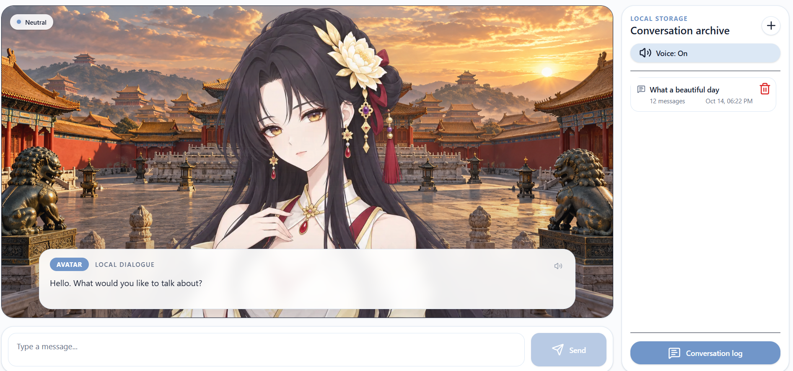

# AI Avatar — Local AI Character with Voice, Memory & Expressions

**A local AI avatar powered by Qwen, Ollama, and CosyVoice3.**  
Chat with an expressive visual-novel-style character that remembers conversations, reacts with emotions and gestures, and speaks responses.



## Why AI Avatar?

AI Avatar turns a local language model into a character you can actually interact with — not just a text box.

- **Local Qwen AI** — powered by Qwen through Ollama
- **Expressions and gestures** — replies include emotion and character behavior
- **Local voice** — CosyVoice3 brings supported responses to life
- **Conversation memory** — chats are stored locally with SQLite
- **Local-first** — no cloud API is required for the main chat and speech path
- **Responsive interaction** — new messages can interrupt old speech safely
- **Built for Windows 11** — one-command startup after setup

## Quick Start

First time here?

**[Follow the Windows 11 setup guide](WINDOWS_SETUP.md)**

Then start AI Avatar:

```powershell
.\RUN_WINDOWS.cmd
```

Open:

```text
http://localhost:3000
```

That's it — start chatting.

## How It Works

```text
You type a message
        ↓
Qwen understands and replies
        ↓
AI Avatar chooses emotion + gesture
        ↓
Conversation is saved locally
        ↓
CosyVoice3 speaks the reply when supported
        ↓
Your avatar responds on screen
```

The model decides **what to say and how to express it**.  
The application controls **memory, validation, retries, timing, and speech behavior**.

> **LLM for semantic decisions. Deterministic code for control.**

## Built With

| Area | Technology |
| --- | --- |
| AI model | Qwen + Ollama |
| Voice | CosyVoice3 |
| Frontend | Next.js + React + TypeScript |
| Backend | ASP.NET Core + C# |
| Memory | SQLite + EF Core |
| Platform | Windows 11 |

## Verify Your Setup

Run the full verification pipeline:

```powershell
.\VERIFY_WINDOWS.cmd
```

## Documentation

- **[Windows Setup](WINDOWS_SETUP.md)** — installation, prerequisites, startup, and recovery
- **[Voice & TTS Setup](VOICE_TTS_SETUP_WINDOWS.md)** — CosyVoice3 setup and troubleshooting
- **[Project Notes](PROJECT_NOTES.md)** — architecture, engineering decisions, and implementation details

## Like the Project?

If AI Avatar gives you ideas for your own local AI character, **star the repository** and follow the project as it evolves.

---

**AI Avatar** explores a simple idea: a local AI assistant can feel more alive when language, memory, voice, emotion, and character animation work together.